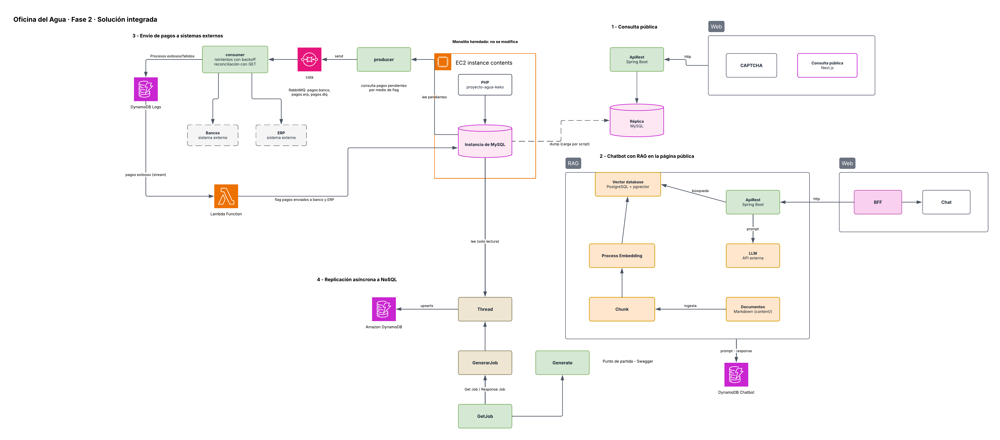
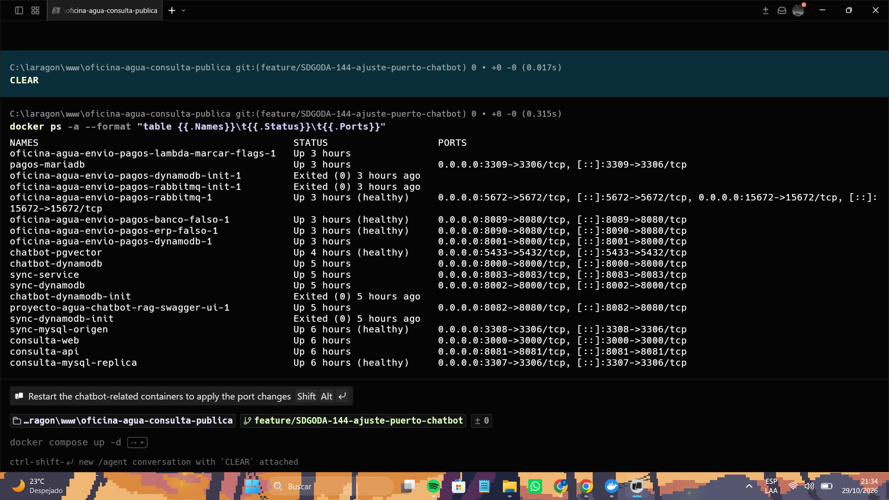
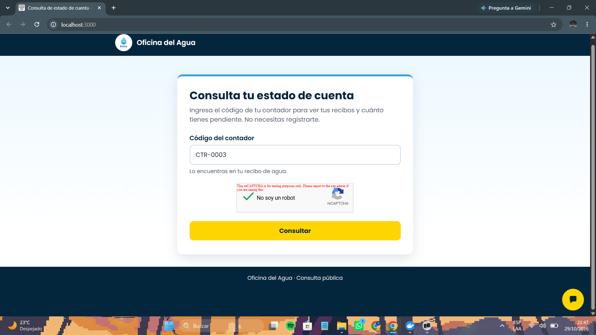
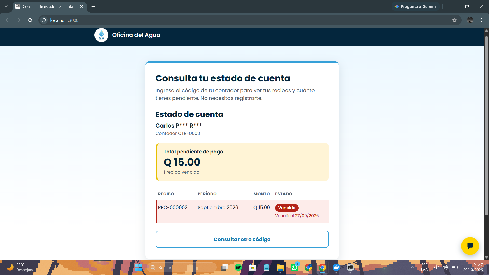
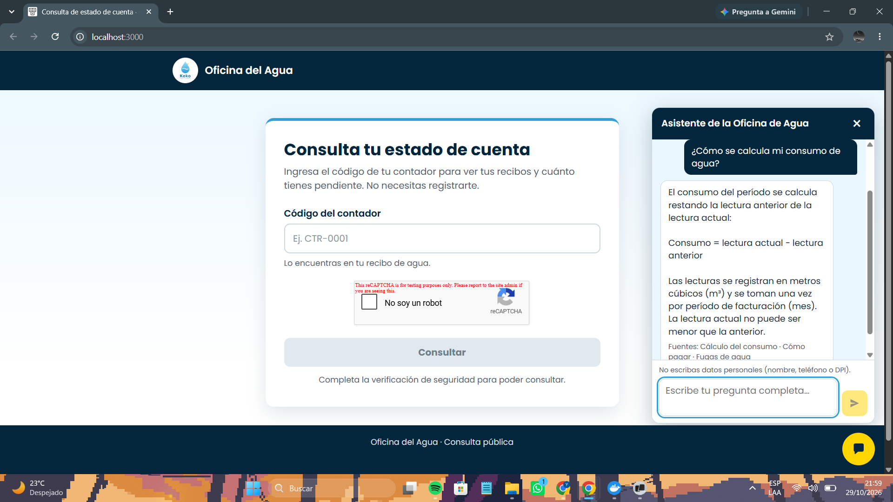
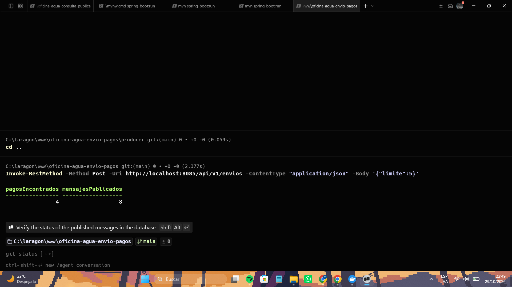
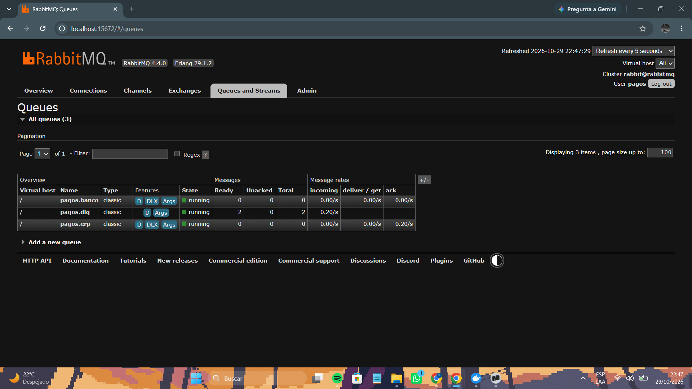
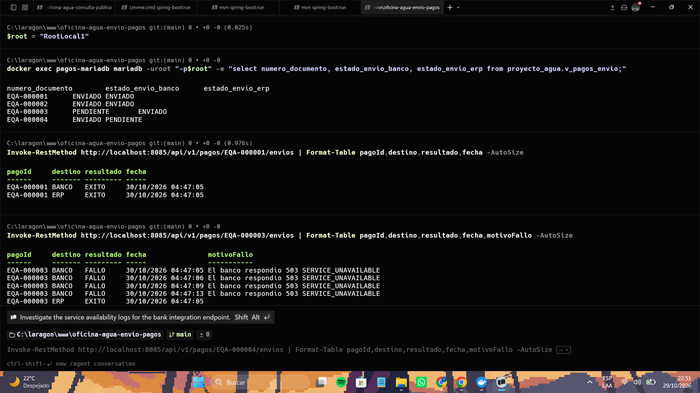
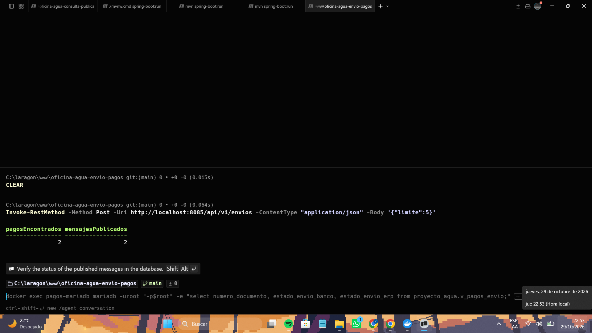
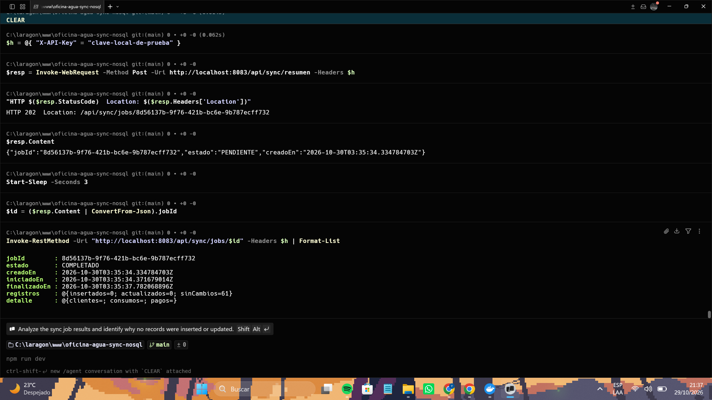

Nombre: Yourgen Kraven Thommel Arevalo  
Carnet: 0905-23-14003  
Repositorio: https://github.com/oficina-agua-keko/oficina-agua-consulta-publica  
Modulo asignado: Consulta pública con captcha  

# Oficina del Agua — Fase 2 · Feature 1: Consulta pública con captcha

Fase 2 · Desarrollo Web 2026 · Universidad Mariano Gálvez

Página pública, **sin login**, donde el cliente final consulta su estado de cuenta con el
número de serie de su contador. Está protegida por captcha (primera barrera) y por rate
limit por IP en el ApiRest (segunda barrera, independiente).

Además de este módulo participé en la **Feature 4** (replicación asíncrona a NoSQL) y en la
**HU-59**, que integra el chat de la Feature 2 en esta misma página.

**Contenido:** [1. Arquitectura de la solución integrada](#1-arquitectura-de-la-solución-integrada) ·
[2. Cómo se ejecuta la solución integrada](#2-cómo-se-ejecuta-la-solución-integrada) ·
[3. Mi módulo: consulta pública con captcha](#3-mi-módulo-consulta-pública-con-captcha) ·
[4. Evidencias](#4-evidencias-de-la-solución-integrada) ·
[5. Seguridad](#5-seguridad-de-la-información) ·
[6. Equipo y flujo de trabajo](#6-equipo-y-flujo-de-trabajo)

---

## 1. Arquitectura de la solución integrada

La Fase 2 agrega **cuatro features nuevas al lado del monolito heredado**. Cada feature vive en
su propio repositorio y se ejecuta con su propio `docker-compose.yml`; se comunican por HTTP,
por colas de mensajes o por lectura de bases de datos, según el caso.



*Diagrama elaborado por el equipo (Enner Godoy). Si la imagen no carga, está en
[`docs/arquitectura-fase2.png`](docs/arquitectura-fase2.png).*

### Repositorios

| Componente | Repositorio |
|---|---|
| Monolito heredado (CodeIgniter 4, PHP 8.2) | [proyecto-agua-keko](https://github.com/KravenTA/proyecto-agua-keko) |
| Feature 1 · Consulta pública con captcha | [oficina-agua-consulta-publica](https://github.com/oficina-agua-keko/oficina-agua-consulta-publica) (este repositorio) |
| Feature 2 · Chatbot con RAG | [proyecto-agua-chatbot-rag](https://github.com/oficina-agua-keko/proyecto-agua-chatbot-rag) |
| Feature 3 · Envío de pagos a sistemas externos | [oficina-agua-envio-pagos](https://github.com/oficina-agua-keko/oficina-agua-envio-pagos) |
| Feature 4 · Replicación asíncrona a NoSQL | [oficina-agua-sync-nosql](https://github.com/oficina-agua-keko/oficina-agua-sync-nosql) |

### Monolito heredado

Sistema existente en **CodeIgniter 4 (PHP)** con su base MySQL de la Oficina del Agua
(clientes, contadores, lecturas, recibos, pagos). **No se modifica su código ni sus tablas
existentes.** Las features lo consultan de forma indirecta:

- Feature 1 usa una **réplica** cargada con un dump, nunca la base original.
- Feature 4 lee la base de origen con un usuario de **solo lectura**.
- Feature 3 lee los pagos pendientes con un usuario de solo lectura sobre una **vista**
  (`v_pagos_envio`). Los únicos objetos nuevos que sus scripts de `db/` agregan en esa base
  son la tabla `pagos_envio` (marcas de entrega) y esa vista, con usuarios de permisos mínimos
  (`pagos_ro`: `SELECT` sobre la vista; `lambda_flags`: `INSERT` sobre `pagos_envio`).

### Componentes por feature

| Feature | Componentes | Tecnología |
|---|---|---|
| **1 · Consulta pública** | Página pública con captcha · ApiRest de consulta · Réplica MySQL | Next.js · Spring Boot · MySQL |
| **2 · Chatbot con RAG** | Widget de chat y BFF · ApiRest del chatbot · Vector database · Proceso de ingesta (chunk + embeddings) · LLM · DynamoDB del chatbot | Paquete `oficina-agua-chat-widget` · Spring Boot · PostgreSQL + pgvector · API externa de LLM y embeddings · DynamoDB |
| **3 · Envío de pagos** | Producer · cola · Consumer · Bancos y ERP (sistemas externos) · DynamoDB de logs · Lambda | Spring Boot · RabbitMQ · DynamoDB · Python |
| **4 · Replicación a NoSQL** | sync-service (generar job, consultar job, replicar) · base de origen · DynamoDB | Spring Boot · MySQL · DynamoDB |

### Qué representa cada conexión

| Flujo | Recorrido |
|---|---|
| **1 · Consulta pública** | Navegador → página Next.js (valida el captcha **en servidor**) → `http` → ApiRest (rate limit por IP) → **Réplica MySQL** (solo lectura). La réplica se carga con un dump de la base del monolito mediante `scripts/refrescar-replica.ps1`. |
| **2 · Chat con RAG** | Documentos Markdown (`content/`) → *chunk* → *embeddings* → vector database (ingesta, una vez). En cada pregunta: navegador → widget en la página de la Feature 1 → BFF `/api/chat` → `http` → ApiRest del chatbot → búsqueda en pgvector → *prompt* al LLM externo → respuesta con fuentes. Cada *prompt/response* se guarda en DynamoDB del chatbot. |
| **3 · Envío de pagos** | Producer lee los pagos pendientes por medio de un flag (vista sobre la base de pagos) → publica en RabbitMQ (`pagos.banco`, `pagos.erp`) → Consumer entrega a Bancos y ERP con reintentos con *backoff* y reconciliación con GET → los resultados exitosos y fallidos van a DynamoDB de logs → su *stream* dispara la Lambda → la Lambda marca el envío en `pagos_envio` para que no se reenvíe. Los mensajes que agotan sus reintentos van a `pagos.dlq`. |
| **4 · Replicación a NoSQL** | `POST /api/sync/resumen` crea un *job* y responde `202` con su `jobId` → el servicio lee la base de origen (solo lectura) en segundo plano y hace *upserts* en DynamoDB → `GET /api/sync/jobs/{jobId}` consulta el estado (`PENDIENTE`, `COMPLETADO`…). |

### Cómo leer el diagrama frente a la implementación

- El **chat de la Feature 2 no es una página aparte**: el widget y su BFF se montan dentro de la
  aplicación Next.js de la Feature 1 (HU-59). El diagrama los dibuja como bloque separado
  porque son dos features distintas.
- En local, DynamoDB corre como **DynamoDB Local** y el broker es **RabbitMQ**. Los sistemas
  externos (Bancos y ERP) se simulan con **WireMock** (por defecto) o con el **simulador del
  docente** (HU-61), según las variables `BANCO_URL` y `ERP_URL` del `.env`.
- Los nombres *Thread / GenerarJob / Generate / GetJob* del bloque 4 son conceptuales; en el
  servicio son los endpoints `POST /api/sync/resumen` y `GET /api/sync/jobs/{jobId}`.
- Los *embeddings* y el LLM del chatbot se consumen de una API externa; su clave nunca se
  versiona ni llega al navegador.

---

## 2. Cómo se ejecuta la solución integrada

No existe un `docker-compose.yml` único: **cada feature tiene el suyo**, y se levantan una a
una. Todos los puertos son configurables por variables de entorno, así que las cuatro pueden
convivir en la misma máquina.

**Requisitos:** Docker Desktop, Git, Java 21 o superior y Maven 3.9+ (producer y consumer de la
Feature 3; el ApiRest del chatbot trae su propio `mvnw`) y Node 22+ solo para correr las
pruebas de la capa web.

### Puertos usados en la prueba integrada

| Feature | Servicio | Puerto |
|---|---|---|
| 1 | web · api · réplica MySQL | 3000 · 8081 · 3307 |
| 2 | ApiRest del chatbot (`SERVER_PORT`) · pgvector · DynamoDB · Swagger UI | 8084 · 5433\* · 8000 · 8082 |
| 3 | RabbitMQ (AMQP / consola) · DynamoDB · banco falso · ERP falso · producer · consumer · base de pagos | 5672 / 15672 · 8001 · 8089 · 8090 · 8085 · 8086 · 3309 |
| 4 | sync-service · base de origen · DynamoDB | 8083 · 3308 · 8002 |

\* El puerto por defecto de pgvector es `5432`. Si en tu máquina hay un PostgreSQL instalado,
cámbialo con `POSTGRES_PORT` y apunta la API con `VECTOR_DB_URL`.

### Orden de arranque

**Feature 4** (solo Docker):
```bash
git clone https://github.com/oficina-agua-keko/oficina-agua-sync-nosql.git
cd oficina-agua-sync-nosql
cp .env.example .env     # SYNC_API_KEY=<una clave local>, DYNAMODB_HOST_PORT=8002
docker compose up -d --build
```

**Feature 1** (este repositorio):
```bash
git clone https://github.com/oficina-agua-keko/oficina-agua-consulta-publica.git
cd oficina-agua-consulta-publica
cp .env.example .env     # ajustar valores; nunca subir el .env
docker compose up -d --build
powershell -ExecutionPolicy Bypass -File scripts\refrescar-replica.ps1   # carga la réplica
```

**Feature 2** (chatbot):
```bash
git clone https://github.com/oficina-agua-keko/proyecto-agua-chatbot-rag.git
cd proyecto-agua-chatbot-rag
cp .env.example .env
docker compose up -d                       # pgvector, DynamoDB, Swagger UI
cp api/secrets.properties.example api/secrets.properties
# editar api/secrets.properties y poner chatbot.llm.api-key=<tu clave> (archivo no versionado)
cd api
./mvnw spring-boot:run -Dspring-boot.run.arguments=--ingesta   # solo la primera vez
SERVER_PORT=8084 ./mvnw spring-boot:run                        # deja esta terminal abierta
```
En Windows (PowerShell): `$env:SERVER_PORT=8084` y `.\mvnw.cmd`. El ApiRest de la Feature 1
ya usa el 8081, por eso el chatbot corre en el 8084 y `CHAT_API_URL` apunta a él.

**Feature 3** (envío de pagos): necesita una base MySQL/MariaDB con las tablas del monolito y
los scripts de `db/` aplicados (`00-pagos_envio.sql`, `01-v_pagos_envio.sql`,
`02-usuarios.sql`). Para probar sin tocar la base real puede usarse un MariaDB desechable
cargado con los scripts de `db/origen/` de la Feature 4. Después:
```bash
git clone https://github.com/oficina-agua-keko/oficina-agua-envio-pagos.git
cd oficina-agua-envio-pagos
cp .env.example .env      # puertos, usuarios de base y RabbitMQ (ver README del repositorio)
# Por defecto Bancos y ERP son los simuladores locales (WireMock). Para usar el simulador del
# docente se cambian BANCO_URL, ERP_URL y sus claves en el .env (la clave la entrega el docente
# y nunca se versiona); SIMULACION_ESCENARIO elige el escenario a simular.
docker compose up -d --build        # RabbitMQ, DynamoDB, simuladores locales y Lambda
cd consumer && SERVER_PORT=8086 mvn spring-boot:run    # terminal 1
cd producer && SERVER_PORT=8085 mvn spring-boot:run    # terminal 2
```

Cada repositorio detalla sus variables en su `.env.example` y su README.

---

## 3. Mi módulo: consulta pública con captcha

### 3.1 Funcionalidad y objetivo

**Problema del negocio.** El cliente de la Oficina del Agua necesita conocer su saldo sin
depender de un trámite presencial, pero el monolito que cobra y registra los pagos no debe
recibir tráfico público: más consultas significarían más carga y más riesgo sobre él. La
Feature 1 resuelve ambas cosas con una consulta pública acotada y aislada del monolito.

**Qué se construyó.** Una página pública, sin login, donde el cliente escribe el número de
serie de su contador, resuelve un captcha y ve su estado de cuenta: datos del contador y de
sus recibos, sin datos sensibles. Tiene tres capas:

1. **Web (Next.js).** Formulario, captcha y presentación del estado de cuenta. Valida el
   captcha **en el servidor** antes de llamar al ApiRest.
2. **ApiRest de consulta (Spring Boot).** Diseñada *contract-first* (primero el contrato OpenAPI).
   Aplica rate limit por IP, y devuelve solo los datos permitidos.
3. **Réplica MySQL.** Copia de solo lectura de la base del monolito, cargada con un dump.

Además aloja el **widget de chat** de la Feature 2 (ver 3.2).

### 3.2 Integración y responsabilidades

| Componente | Se comunica con | Por qué esa frontera |
|---|---|---|
| Web (Next.js) | ApiRest de consulta (`http`) · BFF `/api/chat` (mismo servidor) | **No accede a ninguna base de datos**; solo habla con APIs. |
| ApiRest de consulta | Réplica MySQL | Usuario de **solo lectura**. Nunca ve la base original: si la API se compromete, el monolito sigue intacto. |
| Réplica MySQL | Se carga desde el monolito con `scripts/refrescar-replica.ps1` | El monolito no se modifica ni recibe tráfico público. |
| BFF del chat (`/api/chat`) | ApiRest del chatbot (Feature 2) por `http` | La URL del ApiRest del chatbot y la clave del LLM **viven en el servidor**; el navegador solo llama a `/api/chat`. |

Reglas que se cumplen: el monolito heredado no se modifica; Next.js no accede directamente a
la base de datos; ninguna clave de API se expone al navegador; ningún dato sensible (DPI, NIT,
teléfono) sale en la consulta pública.

**HU-59: chat en esta página.** El widget se instala como **dependencia** (paquete
`oficina-agua-chat-widget`, release `widget-v1.0.0` del repositorio de la Feature 2); en este
repositorio **no hay código del chat copiado**. Solo hay tres puntos de montaje en `web/`:

| Archivo | Qué hace |
|---|---|
| `web/package.json` | Dependencia `oficina-agua-chat-widget`, tomada del release del repositorio de la Feature 2. |
| `web/src/app/api/chat/route.ts` | BFF del chat: una línea que reexporta el *route handler* del paquete. |
| `web/src/app/page.tsx` | Muestra `<ChatWidget />` en la misma página del captcha y carga sus estilos. |

Configuración solo por variables de entorno (ver `.env.example`):

| Variable | Descripción |
|---|---|
| `CHAT_API_URL` | URL del ApiRest del chatbot. Solo la lee el servidor Web. |
| `CHAT_TIMEOUT_MS` | Espera máxima al ApiRest del chatbot (por defecto `70000`). |
| `CHAT_RATE_LIMIT_MAX` / `CHAT_RATE_LIMIT_WINDOW_SECONDS` | Límite de preguntas por IP del chat (por defecto 10 por 60 s). |

El ApiRest del chatbot **no corre en este `docker-compose.yml`**: se levanta desde el repositorio
de la Feature 2. Dentro de Docker, `host.docker.internal` es la máquina anfitriona. Si ese
servicio no está disponible, el formulario de consulta sigue funcionando y el chat solo muestra
que el asistente no está disponible. Para actualizar el widget se cambia la versión en la URL
de la dependencia y se ejecuta `npm install` dentro de `web/`.

### 3.3 Decisiones técnicas

**a) Captcha y rate limit como dos barreras independientes.** El captcha frena a los
programas automáticos que llenan el formulario; el rate limit por IP en el ApiRest frena a
quien llama a la API directamente, saltándose la página. Una sola barrera deja un hueco: el
captcha no protege la API expuesta y el rate limit solo no distingue a un humano de un script
distribuido. Se eligió validar el captcha **en el servidor de Next.js** (no en el navegador) porque
un token validado en el cliente puede ser falsificado.

**b) Réplica de solo lectura en lugar de consultar la base del monolito.** Se descartó que la
API leyera directamente la base original, aunque fuera con un usuario restringido, porque
acoplaría el tráfico público a la base que cobra y registra pagos. La réplica aísla la carga y
limita el daño posible; el costo es que los datos se refrescan con un script y no son en tiempo real.

**c) Widget como dependencia desde un *release*, no copiando código ni usando una URL de git.**
El paquete del chat vive en la carpeta `widget/` del repositorio de la Feature 2 y su carpeta
`dist/` no está versionada, por lo que instalarlo desde git no funciona. Se instala el `.tgz`
publicado como *release*, con versión fija e *integrity* en `package-lock.json`. Así la
Feature 1 no duplica código, y actualizar el widget es cambiar una versión.

### 3.4 Instrucciones para probar el módulo

**Requisito previo:** la réplica debe estar cargada (ver sección 2).

1. Abrir **http://localhost:3000**.
2. Escribir el contador de prueba `CTR-0003` y resolver el captcha.
3. Pulsar **Consultar**.
4. **Resultado esperado:** se muestra el estado de cuenta del contador. Sin resolver el captcha
   el formulario no consulta y muestra que es obligatorio.
5. Probar el chat: abrir el botón de abajo a la derecha y preguntar, por ejemplo,
   «¿Cómo se calcula mi consumo de agua?». **Esperado:** una respuesta con sus fuentes. Con el
   ApiRest del chatbot apagado, el chat indica que el asistente no está disponible y la
   consulta sigue funcionando.
6. Swagger del ApiRest de consulta: <http://localhost:8081/swagger-ui.html>.

**Pruebas automatizadas de la capa web:**
```bash
cd web
npm ci
npm test            # 140 pruebas
npm run typecheck
```

Datos de prueba: `CTR-0003` (contador). Las claves de captcha del `.env.example` son las de
prueba públicas de Google; ninguna credencial real se versiona.

---

## 4. Evidencias de la solución integrada

Las capturas muestran las cuatro features corriendo juntas en una misma máquina. Las de la
Feature 3 se tomaron con los simuladores locales (WireMock), que fallan a propósito con
algunos pagos para mostrar los reintentos y la cola de mensajes fallidos.

**Contenedores de las cuatro features en ejecución**


**Feature 1 · consulta pública.** Captcha resuelto y estado de cuenta resultante.



**Features 1 y 2 · chat en la misma página, con respuesta y fuentes (HU-59)**


**Feature 3 · envío de pagos.** Se encontraron 4 pagos y se publicaron 8 mensajes (uno por pago y por destino).


Las colas en RabbitMQ: `pagos.banco` y `pagos.erp` quedan vacías y `pagos.dlq` conserva los dos
envíos que los simuladores rechazan a propósito.


Estado de cada pago y su historial de intentos: los entregados quedan `ENVIADO`; los que
fallan muestran reintentos con espera creciente.


Repetir el envío no duplica nada: solo se republican los dos destinos pendientes.


**Feature 4 · replicación asíncrona.** `202` con el `jobId` y el job en `COMPLETADO`.


---

## 5. Seguridad de la información

- Ninguna contraseña, token ni clave de API se versiona: viven en variables de entorno, y los
  repositorios incluyen un `.env.example` con valores de ejemplo. El `.env` está en `.gitignore`.
- La clave del LLM del chatbot va en `api/secrets.properties`, archivo no versionado de la
  Feature 2, y nunca llega al navegador.
- Las claves de captcha del ejemplo son las de prueba públicas de Google.
- La API de consulta y la de replicación usan usuarios de base de datos de **solo lectura**.
- La API de replicación exige la cabecera `X-API-Key`.

---

## 6. Equipo y flujo de trabajo

| Nombre completo | Carnet | Correo electrónico | Rol dentro del equipo |
|---|---|---|---|
| Yourgen Kraven Thommel Arevalo | 0905-23-14003 | ythommela@miumg.edu.gt | Coordinador |
| Karen Yamileth Jiménez Galicia | 0905-23-7626 | kjimenezg6@miumg.edu.gt | Desarrolladora |
| Enner Osvaldo Godoy Ramirez | 0905-23-15908 | egodoyr2@miumg.edu.gt | Desarrollador |
| Oliver Isaac Godoy Salguero | 0905-23-10816 | ogodoys@miumg.edu.gt | Desarrollador |

**Proyecto en Jira:** SDGODA · Épica 11 — Feature 1.

### Estructura del repositorio

```
.
├── api/                  ApiRest de consulta (Spring Boot) — HU-20, HU-23, HU-24
├── web/                  Capa Web (Next.js) con captcha y widget de chat — HU-25, HU-26, HU-27, HU-59
├── db/replica/           Réplica MySQL: usuario de solo lectura y carga — HU-22
├── scripts/              Scripts de apoyo (refrescar la réplica)
├── docs/                 Diagrama de arquitectura y capturas
├── .github/              Plantilla de pull request
├── docker-compose.yml    Orquestación de la feature — HU-21
├── .env.example          Variables de entorno (copiar a .env)
└── README.md
```

### Flujo de trabajo

Se trabaja con ramas y pull requests. **Nunca directo sobre `main`.**

```bash
git checkout main
git pull
git checkout -b feature/SDGODA-XX-descripcion-corta
```

Prefijos de commit: `feat:` funcionalidad nueva · `fix:` correcciones · `chore:` configuración y
mantenimiento · `refactor:` reorganizar sin cambiar comportamiento · `style:` formato ·
`docs:` documentación. Antes de abrir el PR se trae `main` a la rama
(`git fetch origin` y `git merge origin/main`).

### Reglas de esta fase

- El monolito heredado no se toca, ni para agregar un endpoint de lectura.
- El ApiRest solo ve la réplica MySQL, nunca la instancia original.
- Contract-first: primero el YAML de OpenAPI, después el código.
- Ningún dato sensible (DPI, NIT, teléfono) sale en la consulta pública.
- Claves y credenciales solo en variables de entorno, documentadas en `.env.example`.

### Documentación elaborada con ayuda de IA

La sección de arquitectura de la solución integrada se redactó con ayuda de un asistente de IA
(Claude), a partir de los README, los `docker-compose.yml`, los scripts de base de datos y el
código de los cuatro repositorios, y se contrastó con la ejecución real de cada feature. Los
puertos, endpoints y flujos descritos son los que se probaron.
